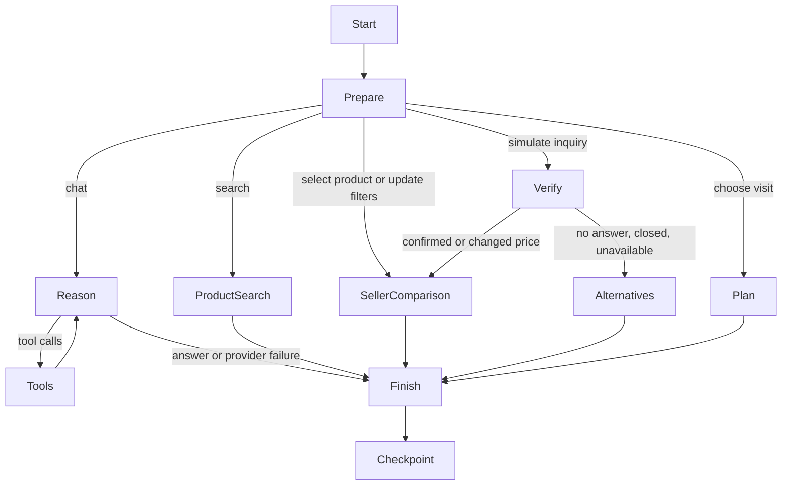

# Purchase workflow

The HTTP server runs a LangGraph `StateGraph` for each browser purchase session. UI actions and model tool decisions share the same persisted state. Model credentials stay in the server environment; no Liara requests or remote publication are part of local development.

## State and persistence

- A random UUID in an HttpOnly, SameSite cookie identifies a local purchase session. No session ID supplied in the request body is used.
- State includes recent messages, explicit preferences, selected product, seller inquiry results, chosen offer, stage, token counts and the most recent execution trace.
- `SqliteCheckpointer` implements LangGraph's checkpoint saver contract using Node SQLite and LangGraph's typed serializer. Checkpoints, parent references and pending task writes persist in `data/workflow.db`.
- Browser reloads hydrate state through `GET /api/session`. UI transitions use `POST /api/workflow`. Model requests use the separate rate-limited `POST /api/chat` route.
- A per-session execution lock prevents overlapping graph mutations. Independent sessions do not share conversation or inquiry results.
- Explicitly starting a new purchase deletes that session's checkpoints and writes. Automated retention, account authentication, quota enforcement across restarts and production backups remain deployment work.

## Model boundary

The graph calls BoxAPI directly through its compatible chat endpoint. LangGraph decides routing, state updates and tool iteration; a separate LangChain model adapter is unnecessary.

The model can update stated preferences, search products, compare specifications and look up sellers. It cannot place calls, make purchases, alter source prices or write arbitrary files. Latitude and longitude are omitted from its system context and tool responses. User-entered chat text is sent as entered, so users should avoid typing personal location details into chat.

Each turn allows at most three model calls and four tool calls per decision, with tools disabled on the final call. Deterministic filtering, inquiry simulation and fallback ranking do not spend model credit. Every successful provider response records token usage immediately, including intermediate tool decisions.

## Information quality

Source offers are not evidence of current stock. Inquiry results are explicitly simulated and never overwrite source data. Failed sellers remain visible after eligible alternatives. A visit cannot be planned for a seller that failed the simulated inquiry. Payment channels must explicitly support in-person installments to pass that filter. Distances are straight-line estimates, not routes or travel times.

## Validation

Tests cover dataset relationships, budget and installment filters, Tehran schedules, ranking, checkpoint recovery after closing and reopening SQLite, session separation, tool-driven preference changes, fallback routing, provider failure recovery and concurrent mutation rejection. Tests use an injected model stub and do not spend API credit.
