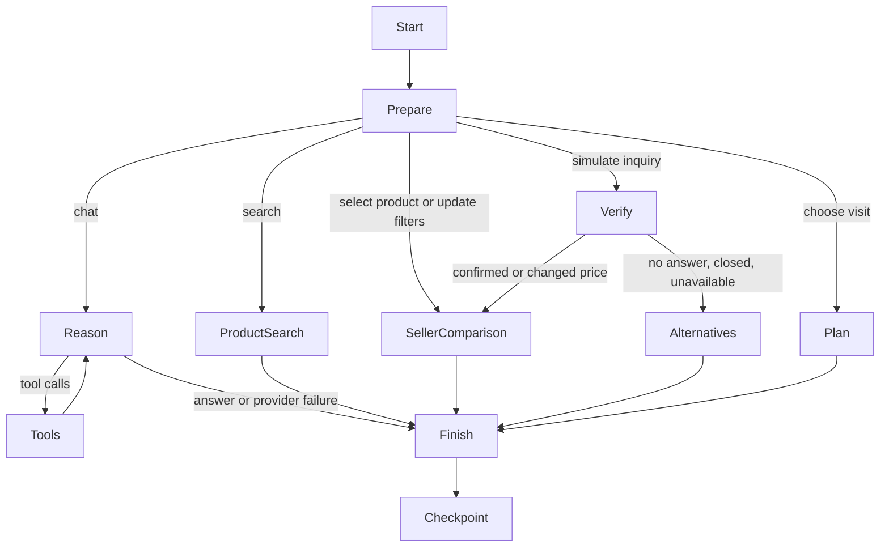

# Purchase workflow

The HTTP server runs a LangGraph `StateGraph` for each browser purchase session. UI actions and model tool decisions share the same persisted state. Model credentials stay in the server environment; no Liara requests or remote publication are part of local development.

## State and persistence

- Each conversation has a random UUID stored with the tab conversation list in sessionStorage and sent in the X-Torob-Session header. Clients without that header use an HttpOnly, SameSite session cookie. No session ID supplied in the request body is used. These identifiers provide isolation, not account authentication.
- State includes recent messages, explicit preferences, selected product, seller inquiry results, chosen offer, stage, token counts and the most recent execution trace.
- `SqliteCheckpointer` implements LangGraph's checkpoint saver contract using Node SQLite and LangGraph's typed serializer. Checkpoints, parent references and pending task writes persist in `data/workflow.db`.
- Browser reloads hydrate state through `GET /api/session`. UI transitions use `POST /api/workflow`. Model requests use the separate rate-limited `POST /api/chat` route.
- A per-session execution lock prevents overlapping graph mutations. Independent sessions do not share conversation or inquiry results.
- The menu creates independent conversations and switches between their checkpoints within the same tab session. Closing the tab drops the browser list, but does not delete server checkpoints. The reset API deletes one conversation. A new item resets product requirements and the model context boundary while preserving visible messages and the shopping origin. Automated retention, account authentication, quota enforcement across restarts and production backups remain deployment work.

## Model boundary

The graph calls BoxAPI directly through its compatible chat endpoint. LangGraph decides routing, state updates and tool iteration; a separate LangChain model adapter is unnecessary.

The model can update stated preferences, search products, compare specifications and look up sellers. It cannot place calls, make purchases, alter source prices or write arbitrary files. Latitude and longitude are omitted from its system context and tool responses. User-entered chat text is sent as entered, so users should avoid typing personal location details into chat.

Each turn allows at most three model calls and four tool calls per decision, with tools disabled on the final call. Deterministic filtering, inquiry simulation and fallback ranking do not spend model credit. Every successful provider response records token usage immediately, including intermediate tool decisions.

Final model answers use JSON with `text`, optional retrieved `productIds`, and up to two choice questions. Product identifiers are checked against retrieved catalogue results; names, images and all-seller price ranges are loaded from SQL. Each assistant message persists its own UI payload, so older cards and questions survive reloads. The browser renders text and choices through DOM text nodes, never arbitrary model HTML. “Other” opens a manual answer field.

`POST /api/chat/pause` aborts the active provider connection and waits for the graph to checkpoint a paused state. The graph skips finalization while paused, retaining completed tools, conversation input and token counters. `POST /api/chat` with `resume: true` resumes the saved work without adding another user message. A fresh message after pausing preserves earlier user requirements but replaces the unfinished tool loop. Cancellation does not promise a provider refund or freeze remote token generation.

## Information quality

Source offers are not evidence of current stock. Inquiry results are explicitly simulated and never overwrite source data. Failed sellers remain visible after eligible alternatives. A visit cannot be planned for a seller that failed the simulated inquiry. Payment channels must explicitly support in-person installments to pass that filter. Distances are straight-line estimates, not routes or travel times.

## Validation

Tests cover dataset relationships, budget and installment filters, Tehran schedules, ranking, checkpoint recovery after closing and reopening SQLite, session separation, tool-driven preference changes, fallback routing, provider failure recovery and concurrent mutation rejection. Tests use an injected model stub and do not spend API credit.

## App experience and scope

The mobile conversation screen centers the composer until the first message, then fixes it at the bottom. The menu restores separate conversations within the current tab session. The animated SVG mascot respects reduced-motion preferences.

The system policy limits answers to product selection and in-person shopping. Structured out_of_scope responses are replaced with a fixed shopping redirect and cannot execute tools or render cards. Scope classification still depends on model compliance; it is not a guarantee against every adversarial prompt.

Seller comparison automatically checks the nearest eligible offers when a location is available. Closed schedules are skipped; failed or over-budget simulated responses fall back to the next offer, with at most three contacts and a per-contact timeout. Matching variant results are reused for 15 minutes. The adapter is simulation-only and cannot make real calls. Source prices remain unchanged. Optional shop website/social links are preserved by the importer or scripts/sync-shop-links.mjs.
